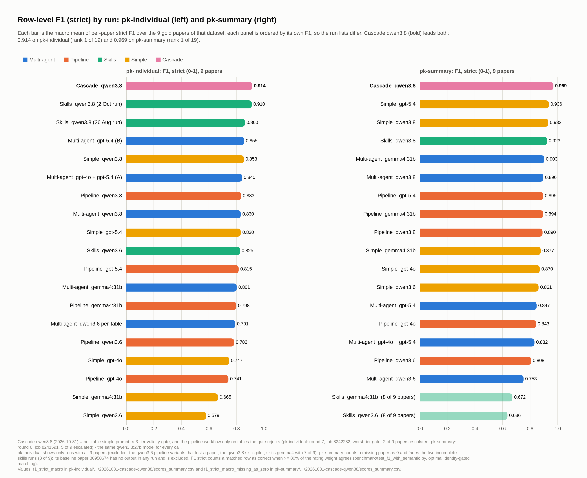

# Cascade mode: per-paper F1 of the final result vs. Arm A vs. Arm B (qwen3.8 both arms)

Per-paper strict F1 of the v2 per-table cascade against the gold tables, next to the F1 each arm
would have given on its own. Both runs used Arm A = `qwen3.8:27b` simple prompt and Arm B = the
pipeline workflow (`arm_b_mode = "pipeline"`) with `QWEN3.8-27B`, which also serves Tier 3 and the
Tier 4 judge. Strict F1 is the benchmark's identity-gated optimal row matching with row threshold 8
(`benchmark/test_f1_with_semantic.py`).

Columns:

- **f1_escalate** - the cascade's final output for the paper (Arm A's table, or Arm B's table where
  the gate escalated and the judge picked B), from this run.
- **f1_A** - the paper rebuilt from Arm A's table on every selected table, from this run.
- **f1_B** - on escalated papers (Y): the paper with Arm B's table substituted on the escalated
  tables, from this run. On non-escalated papers (N) Arm B never ran, so the value marked `ref` is the
  stored whole-paper pipeline-qwen3.8 collection (`pipeline_qwen38` set of the benchmark comparison
  snapshot `.../benchmark_results/20261031-cascade-qwen38/f1_matrix_strict.csv`), scored with the same
  matcher. A `ref` value is a different kind of number: the pipeline over the whole paper in an earlier
  run, not Arm B on this run's selected tables.
- **escalated** - whether at least one of the paper's selected tables was sent to Arm B.

## pk_individual - round 7 (job 8242232, 2026-10-31)

Work dir `.curate_agent_calibration/pk_individual_qwen38_pipeline_r7/`, scratch
`curate_agent_cascade/cascade_v2r4_pki_pipeline_r7-8242232_*`. Gate rule: worst tier (max of the tier
error rates), escalation threshold 0.2.

| pmid | f1_escalate | f1_A | f1_B | escalated (Y/N) |
|---|---|---|---|---|
| 10971311 | 0.714 | 0.714 | 0.990 ref | N |
| 11849190 | 0.976 | 0.976 | 1.000 ref | N |
| 18426260 | 1.000 | 1.000 | 0.378 ref | N |
| 23200982 | 0.893 | 0.893 | 0.924 ref | N |
| 24989434 | 1.000 | 1.000 | 0.636 ref | N |
| 32056930 | 0.841 | 0.841 | 0.886 ref | N |
| 32153014 | 1.000 | 0.667 | 1.000 | Y |
| 33253437 | 0.912 | 0.912 | 0.856 ref | N |
| 34746508 | 0.889 | 0.588 | 0.889 | Y |
| **mean** | **0.914** | 0.844 | 0.840 (mixed) | 2 of 9 |

Both escalations (32153014 t2, 34746508 t2) were decided by the LLM judge in favour of B, and B was
right both times. The non-escalated papers below the `ref` value (10971311, 23200982, 32056930) are
label or recall misses that none of the three gate tiers counts as an error: on 32056930 the 27 lost
rows are the 3 x 9 concentration/dose-ratio rows of Table 2, where Arm A left Specimen and Parameter
unit blank, wrote "concentration-dose ratio" as the parameter type and "maternal" in
Pediatric/Gestational age; every value is correct, each row rates 7 of 10, one under the threshold.
The gate correctly kept Arm A on 18426260 and 24989434, where the pipeline collection scores 0.378 and
0.636.

## pk_summary - round 6 (job 8241591, 2026-10-31)

Work dir `.curate_agent_calibration/pk_summary_qwen38_pipeline_r6/`, scratch
`curate_agent_cascade/cascade_v2r6_pks_pipeline_r6-8241591_*`. Gate rule at the time of this run: mean
of the tier rates (the worst-tier rule came in with round 7); an offline recount with the worst-tier
rule adds one escalation (22050870 t3). The 9 gold papers with source HTML; 30950674 has none.

| pmid | f1_escalate | f1_A | f1_B | escalated (Y/N) |
|---|---|---|---|---|
| 16143486 | 0.918 | 0.533 | 0.918 | Y |
| 17635501 | 0.966 | 0.966 | 0.848 ref | N |
| 22050870 | 0.857 | 0.667 | 0.857 | Y |
| 29943508 | 1.000 | 1.000 | 1.000 ref | N |
| 30825333 | 1.000 | 0.000 | 1.000 | Y |
| 34114632 | 0.983 | 0.333 | 0.983 | Y |
| 34183327 | 1.000 | 0.000 | 1.000 | Y |
| 35465728 | 1.000 | 1.000 | 0.444 ref | N |
| 35489632 | 1.000 | 1.000 | 1.000 ref | N |
| **mean** | **0.969** | 0.611 | 0.894 (mixed) | 5 of 9 |

All five escalations went to B and B was right each time. Arm A's low scores here are mostly not the
model's fault: on 30825333 the model returned all 8 rows of Table 3 correctly, but with no header line
and one trailing comma per row (17 fields instead of 16), and the headerless parser rejected the block
and reported nothing dropped; on 34183327 a 15-name header over 17-field rows made the parser drop all
30 rows; on 16143486, 22050870 and 34114632 qwen3.8 answered one table with a header line only. The
parser fixes and the header-only retry (`think=False`) are in the code (see
`docs/cascade_mode_results.md`, "Why Arm A was so weak here, and what was fixed") but pk_summary has not
been re-run since, so this table shows the pre-fix Arm A. Not escalating 17635501 and 35465728 was
right: Arm A beats the pipeline collection there.

## Sources

- Per-paper f1_escalate / f1_A / live f1_B: the run tables in `docs/cascade_mode_results.md`
  (sections "seventh round, pk_individual" and "pk_summary - sixth round"), computed by
  `scripts/run_cascade_benchmark.py` from each run's own `cascade_report.json` and per-table CSVs.
- `ref` values: `pipeline_qwen38` column of `f1_matrix_strict.csv` in the pk-individual and pk-summary
  snapshots `/fs/scratch/PCON0100/feng1426/projects/playground/tabular-data-benchmark/{pk-individual,pk-summary}/benchmark_results/20261031-cascade-qwen38/`.

## Figure: strict F1 of every run, both datasets

`docs/figures/01_f1_headline_pk_individual_vs_pk_summary.png`: the strict-F1-only counterpart of each
snapshot's `01_headline_scores.png`, left panel pk-individual (19 complete runs, `f1_strict_macro`),
right panel pk-summary (19 runs, `f1_strict_macro_missing_as_zero`, the two incomplete skills runs faded).
Each panel is ordered by its own F1. Generated by `docs/figures/make_f1_headline.py` (master copy and
output also in `/fs/scratch/PCON0100/feng1426/projects/playground/tabular-data-benchmark/combined/20261101-f1-headline/`;
needs the `tabular-data` conda env for matplotlib).
